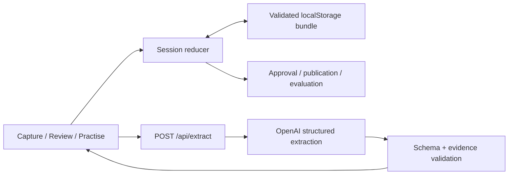

# BOOMERANG — Architecture and frozen stack

Version 1.2.0 · Decision A002 · 7 November 2026

## 1. Stack freeze

This is the single source of truth for technology choices. Implement this stack. Changing a component, major version, model, persistence strategy or hosting platform requires explicit user approval, a recorded reason/impact and an updated baseline before implementation. Missing credentials or setup errors are blockers to resolve, not permission to switch providers.

| Area | Fixed choice | Purpose |
| --- | --- | --- |
| Runtime | Node.js 24 LTS | Stable Next.js runtime for local tools and deployed Vercel functions |
| Package manager | Bun 1.4 | Dependency installation, committed bun.lock and script commands |
| Application | Next.js 16 App Router; React 19.2; TypeScript 5 strict | UI and server routes in one application |
| Styling | Tailwind CSS 4; native semantic controls | Shared visual tokens without a component-library dependency |
| Client state | React `useReducer` with pure domain functions | Explicit, testable transitions |
| Validation | Zod 4 | Shared runtime schemas and inferred types |
| Model integration | Official OpenAI TypeScript SDK; Responses API; structured JSON output | One server-side extraction path |
| Model | `gpt-5.4-mini-2026-03-17` | Pinned snapshot; no moving alias or automatic fallback |
| Storage | Browser localStorage, one versioned JSON bundle | Fictional, single-browser demonstration |
| Tests | Vitest 4 for domain/API adapter tests; manual browser acceptance run | Validate behavior without an extra browser-test framework |
| Hosting | One Vercel project; Node.js server runtime | Deploy the app and extraction route together |
| Optional audio | ElevenLabs HTTP speech-to-text API, `scribe_v2` | Transcribe a short recording into the existing text path |

Exact installed package versions are not yet known: there is no application or lockfile. During Task 1, select compatible stable versions within these lines, use exact direct dependency pins, record the exact Node/Bun and SDK versions in the application README, and commit one `bun.lock`. Set `packageManager` to the resolved exact `bun@x.y.z` version and use `bun install --frozen-lockfile` on every teammate machine and deployment. Commit only `bun.lock` as the dependency lockfile. No `latest` ranges or unreviewed lockfile regeneration after this initial resolution. Audio model access is verified only if its optional gate is reached.

We chose one app over Next.js + separate API/database because all demo state fits in one browser and only extraction requires a server. There is no requirement for shared accounts or server-authoritative publication today. A production data model would be a separate approved change.

### Why this stack fits

Next.js keeps the three screens and extraction endpoint in one deployable app. TypeScript and Zod keep frontend/backend contracts aligned. React state and localStorage cover this small fictional demo without another service. A single server-side provider handles extraction; practice and publication remain deterministic. Vitest runs through `bun run test`; no second test runner is introduced. Tailwind supplies shared design tokens without a component framework.

Bun replaces npm for package management and script invocation. Running `bun run dev` does not itself switch Next.js to Bun's runtime: the CLI and deployed functions retain Node.js 24. This avoids an extra runtime migration while honoring the requested package-manager change. Pin Bun during bootstrap and verify the deployed build.

This is a demo architecture, not a production knowledge platform. A production pilot needs authenticated roles, shared durable storage and server-enforced publication. Those requirements would justify a separate architecture decision after the hackathon.

**Decision A002:** user requested Bun instead of npm. All other fixed choices remain unchanged. Exact dependency pins are established once in Task 1; architecture changes still require explicit approval.

## 2. Boundaries



Browser: editing, explicit approvals, case links, snapshots, practice, gaps and persistence. Server: demo-access check, input limits, provider call, output/evidence validation. Model: propose draft content only. No database, retrieval pipeline, agents, additional backend or external messaging.

The demo access code protects paid model calls; it is not enterprise authentication. Browser snapshots are not a tamper-proof audit log. Only fictional inputs are allowed in this prototype.

## 3. Planned application files

Paths are relative to the application repository root. If the application is built in another checkout, copy the current documentation set to its root first; do not interpret this planning repository's name as an application directory contract.

```text
src/app/layout.tsx                 metadata and global styling
src/app/page.tsx                   session shell, restoration and view switching
src/app/globals.css                design tokens and Tailwind import
src/app/api/extract/route.ts       access, limits, request/response handling
src/components/Capture.tsx         incident editor and expert inbox
src/components/Review.tsx          cards, evidence, links and publication
src/components/Practise.tsx        playbook, cases, feedback and history
src/lib/contracts.ts               Zod schemas and inferred types
src/lib/demo.ts                    initial bundle and separate replay fixtures
src/lib/extract.ts                 provider adapter and evidence validation
src/lib/knowledge.ts               edit, reject, approve, link, publish
src/lib/practice.ts                evaluate, create/deduplicate/resolve gaps
src/lib/session.ts                 reducer and pending-extraction context
src/lib/storage.ts                 validated load/save/reset
tests/extract.test.ts              adapter, evidence and API failures
tests/knowledge.test.ts            approvals, links and immutable versions
tests/practice.test.ts             coverage, choices, gaps and replay
tests/storage.test.ts              persistence, corruption and hydration guards
README.md                         actual setup, versions and demonstration limits
.env.example                      variable names only
package.json / bun.lock  scripts and exact dependency resolution
```

Optional: `/api/transcribe/route.ts` and `src/lib/transcribe.ts` only after the text acceptance gate passes.

## 4. Shared data contract

Define each type through a Zod schema; infer TypeScript types. Runtime validation is required at API and storage boundaries. IDs are app-generated UUIDs except stable fixture IDs.

```ts
type SourceSegment = { id: string; text: string; author: string };
type Evidence = { sourceId: string; quote: string };
type Rule = {
  id: string; situation: string; conditions: string[]; action: string;
  rationale: string | null; exceptions: string[]; evidence: Evidence[];
};
type CaseLink = { caseId: string; ruleId: string; reviewer: string };
type Draft = {
  id: string; revision: number; baseVersion: number;
  rules: Rule[]; approvedRuleIds: string[]; caseLinks: CaseLink[];
};
type KnowledgeVersion = {
  version: number; sources: SourceSegment[]; rules: Rule[];
  caseLinks: CaseLink[]; approvedBy: string; approvedAt: string;
  contentOwner: string;
};
type Scenario = {
  id: string; title: string; facts: string[];
  options: { id: string; label: string }[]; correctOptionId: string;
};
type Attempt = {
  id: string; scenarioId: string; knowledgeVersion: number;
  selectedOptionId: string | null; outcome: 'correct' | 'incorrect' | 'gap';
  ruleId: string | null;
};
type Gap = {
  id: string; scenarioId: string; fromVersion: number; question: string;
  owner: string; status: 'open' | 'closed'; resolvedVersion: number | null;
};
type SessionBundle = {
  schemaVersion: 1; mode: 'live' | 'fixture';
  sources: SourceSegment[]; draft: Draft | null;
  versions: KnowledgeVersion[]; attempts: Attempt[]; gaps: Gap[];
};
```

Expert/owner form fields and pending request context may live in temporary reducer state; publication/creation copies the required names into snapshots/gaps. They do not authorize access. Credentials and pending promises are never stored in `SessionBundle`.

Sources are append-only within a session. Editing an already submitted source creates a new ID. Every rule needs at least one nonempty quote matching its referenced source exactly. Reject unknown/duplicate IDs, blank actions/situations and invalid references. Cards whose evidence is syntactically valid still require semantic review.

## 5. Domain functions

```ts
validateEvidence(rules: Rule[], sources: SourceSegment[]): void
extractRules(sources: SourceSegment[]): Promise<{ rules: Rule[]; questions: string[] }>
editRule(draft: Draft, updated: Rule): Draft
rejectRule(draft: Draft, ruleId: string): Draft
approveRule(draft: Draft, ruleId: string): Draft
approveCaseLink(draft: Draft, scenario: Scenario, ruleId: string, reviewer: string): Draft
publishDraft(input: {
  draft: Draft; expectedDraftId: string; expectedRevision: number;
  current: KnowledgeVersion | null; sources: SourceSegment[];
  reviewer: string; contentOwner: string; now: string;
}): KnowledgeVersion
evaluateCase(scenario: Scenario, selectedOptionId: string | null,
  knowledge: KnowledgeVersion): Attempt
createGap(scenario: Scenario, version: KnowledgeVersion): Gap
resolveGap(gap: Gap, knowledge: KnowledgeVersion): Gap
loadBundle(): SessionBundle | null
saveBundle(bundle: SessionBundle): { persisted: boolean }
resetBundle(): SessionBundle
```

**Drafts:** mutations return copies and increment revision. Edit/reject clears that rule's approval and links. Link only an existing approved rule, known case and nonempty reviewer. Reject a second link; remove the first explicitly before replacing it. An update draft copies the current version's cards/links and retains approvals for unchanged cards; its `baseVersion` is the current version number.

**Publish:** the reducer passes its current draft to `publishDraft` and the click's captured ID/revision as expected values. Reject mismatches and a `baseVersion` unequal to `current?.version ?? 0`. Validate nonempty rules, all approvals, evidence, unique valid case links, reviewer and owner. Create `(current?.version ?? 0) + 1` as a deep copy; source snapshot includes all references. Append it rather than replacing history. These guards protect normal single-browser state flow, not multi-user concurrency.

**Practice:** coverage is checked first. No link or conflicting links → `gap`, with no selected option or recommendation. Valid link + null selection is a validation error, not a saved attempt. An unknown option is rejected and cannot pass. Exact match with `correctOptionId` → `correct`; another known option → `incorrect`. The UI supplies only C1/C2; reject unknown scenario IDs before resolution. Use the linked rule for feedback.

**Gaps:** create question from fixed case facts, copy `contentOwner`, and deduplicate by case/version in the reducer. Resolve only if a newer published snapshot contains a valid link for that case. A reply, draft approval or same-version snapshot cannot resolve it. Old attempts remain unchanged. All v1/v2 operations follow PRD W1–W10.

**Async results:** record pending draft ID/revision (or null when starting a new draft) and a request token. Commit extraction only if the current draft still matches that context and the token is current. Ignore an older/late result; preserve new edits. Disable overlapping extraction in the UI. Reset invalidates pending tokens so a late response cannot repopulate a cleared session.

## 6. API and provider contract

`POST /api/extract`, JSON `{ sources: SourceSegment[] }` → `{ rules: Rule[]; questions: string[] }`. Require `x-demo-access` matching server-only `DEMO_ACCESS_CODE`; compare before provider work. Missing server configuration returns 503 without a provider call.

Bounds: 64 KiB UTF-8 request body, 10,000 total source characters, 1–6 nonempty input segments. Check bytes before parsing and schema/character limits after. Return at most six rules and three questions; a valid zero-rule result is allowed. Set a 20-second abort timeout and SDK automatic retries to zero. UI offers one explicit retry per failed extraction cycle. No silent model substitution.

Use the fixed snapshot with reasoning effort `none`, a strict structured-output schema and `store: false`. Prompt for source-supported decisions, original conditions, missing rationale as null and exact quotes. Do not give the model tools, approval fields or publication functions. Validate the complete response and evidence before returning any rules. An incomplete/refused/provider-error result is an error, not empty successful extraction.

| Status | Meaning |
| --- | --- |
| 400 | Invalid schema, empty input, duplicate IDs or character/segment limit |
| 401 | Missing or incorrect demo access code |
| 413 | Body exceeds byte limit |
| 502 | Refusal, malformed/incomplete output, invalid evidence or provider error |
| 503 | Live extraction not configured |
| 504 | Provider timeout |

Errors: `{ code: string; message: string }`; never expose raw provider messages or credentials. Keep API key and access code in server environment variables. Browser access code stays in memory and is re-entered after reload.

Optional transcription: server-only `ELEVENLABS_API_KEY`, same access check, at most 60 seconds/5 MiB, 20-second timeout, model `scribe_v2`, one supported browser-recorded format verified before enabling. Send via HTTP without adding another SDK. Correct the returned transcript in Capture before extraction; raw audio is not persisted. If model/format support is unavailable, omit audio; changing provider/model still requires approval.

## 7. Persistence and operations

Key: `boomerang.demo.v1`. Validate schema and cross-references: unique IDs/version numbers, quotes, draft approvals/links, attempt versions/rules and gap resolution links. Reject corrupt bundles into recovery UI. A load error differs from no saved bundle. During hydration, do not save defaults. Storage failure keeps memory state with a visible notice.

Reset replaces in-memory and saved state with `initialBundle`, invalidates pending requests, and leaves S1 only. Export JSON is optional, not an acceptance requirement. A fixture replay bundle is separate from initial/live state and permanently labelled; it may include S2/v2 for fallback playback. Switching modes must not mix fixture rules into live history.

Deploy one tested build to Vercel with Node 24 and server-only environment variables. Check missing/wrong access, a real novel extraction, full loop, reload/reset and a signed-out fixture experience. Disable paid live access after judging. No CI pipeline is required to prove the demo; a tested manual deployment is sufficient.

## 8. Planned commands

Task 1 creates these scripts; they do not exist yet:

```text
bun run dev          next dev
bun run build        next build
bun run start        next start
bun run typecheck    tsc --noEmit
bun run test         vitest run
```

For domain changes, run the affected test file. For integration/release, run all tests, typecheck, build and the PRD acceptance flow in the presentation browser.

## 9. Technical references

- [Next.js 16](https://nextjs.org/blog/next-16), [Node.js release lines](https://nodejs.org/en/about/previous-releases), [Bun lockfiles](https://bun.sh/docs/pm/lockfile), [Bun with Next.js](https://bun.sh/guides/ecosystem/nextjs), [Tailwind with Next.js](https://tailwindcss.com/docs/installation/framework-guides/nextjs).
- [Zod](https://zod.dev/), [Vitest 4](https://v4.vitest.dev/guide/).
- [OpenAI SDK](https://github.com/openai/openai-node), [pinned model and structured-output support](https://developers.openai.com/api/docs/models/gpt-5.4-mini).
- [ElevenLabs speech-to-text models](https://elevenlabs.io/docs/overview/models).

Documentation confirms advertised capabilities, not access through the team's account. The live provider smoke test remains required.
