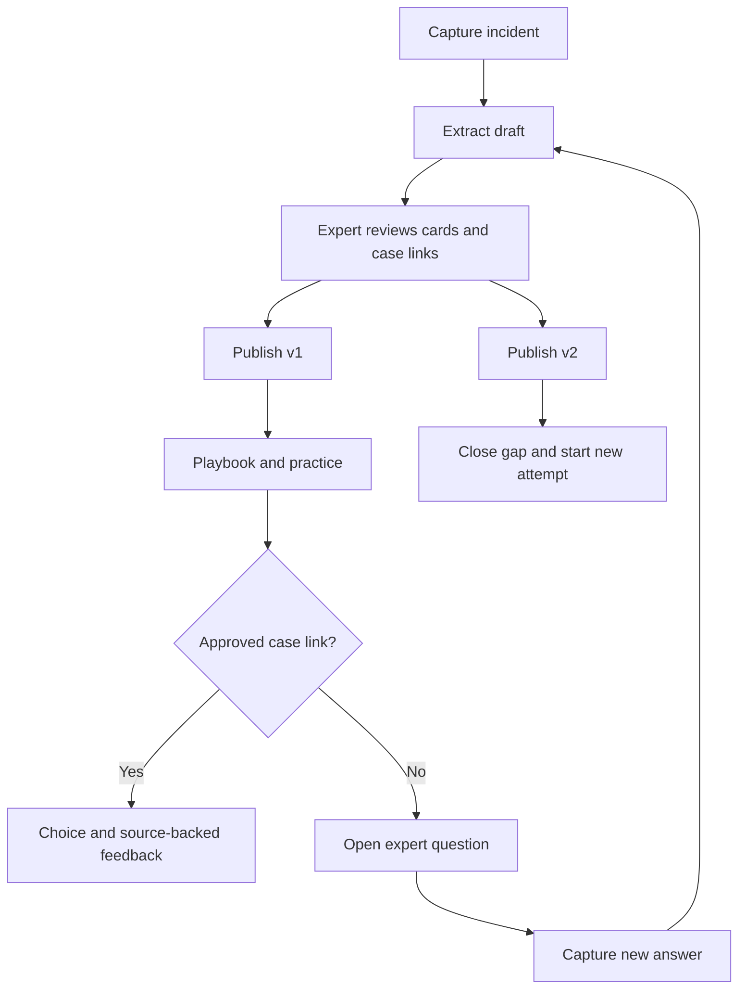

# BOOMERANG — Product requirements

Version 1.2.0 · 7 November 2026 · Experience does not retire.

## 1. Product

BOOMERANG turns an experienced colleague's decisions into reviewed guidance and practice for their successor. When a practice case lacks guidance, the app returns a specific question to the expert. Their reviewed answer becomes a new knowledge version.

The output is a playbook: situation, next action, reasoning, exceptions and source. Practice checks whether a learner chooses the right next step for an explicitly supported case.

## 2. Users

| Role | Job |
| --- | --- |
| Expert | Explain incidents, review extracted guidance, answer gaps |
| Learner | Read approved guidance and practise decisions |
| Content owner | Maintain guidance and handle unanswered cases after the expert leaves |
| Buyer | Operations/service manager responsible for handover and onboarding |

These are views within one demo session, not separate authenticated accounts. The first customer hypothesis is a small or midsized event-operations/service team.

## 3. Scope

Required: text capture, source-linked extraction, human review, immutable publication, readable playbook, two fixed practice cases, gap inbox, expert reply, v2 publication, retry, browser persistence and reset.

Optional: short audio transcription after the complete text flow passes. Text remains the common input path.

Excluded: arbitrary question answering, automatic discovery of every knowledge gap, learner reporting on covered cases, generated courses/videos, knowledge graphs, voice clones, database, cross-device collaboration, billing and LMS integration.

## 4. Workflow

### W1. Start the handover

**Actor:** expert or content owner.

1. Open Capture. See BOOMERANG, the demo label and the current knowledge version.
2. Enter the expert name and continuing content owner. Use Alex and the duty technician for the fictional demo.
3. Describe one incident. The form asks: What happened? What did you notice? What did you do and why? When should someone stop? How did you know it worked?
4. Paste notes directly or use the prepared S1 example. Optional transcription fills the same editable text field.

**Result:** editable incident text. No guidance exists yet. Practice is disabled until a version is published. The initial session contains only S1 as available source material; S2 is withheld from active sources.

### W2. Extract a draft

**Actor:** expert; AI assists.

1. Select **Extract draft**. Save the submitted text as immutable source segments with IDs and author.
2. Show a loading state and disable duplicate submissions. Keep the text visible.
3. Send only the submitted segments to the extraction API. Instructions embedded in the text remain source material.
4. The model returns draft cards and up to three unanswered questions. Each card contains a situation, conditions, action, optional rationale, exceptions and exact source quotations.
5. Validate format, limits, source IDs and quote membership. Assign rule IDs in the app.
6. Add valid cards to the current draft. Existing published versions are untouched. If the draft changed while extraction was running, discard the stale response with a message and preserve the newer draft.

**Result:** unapproved cards in Review. Extraction cannot approve, link a case or publish.

**No usable guidance:** show “No supported guidance found. Add a specific action or example.” Keep the source and allow editing. Missing rationale stays “Not provided”; the app does not invent it.

**API failure:** retain the input, draft and published versions; show the error and one explicit retry. Switching to fixture mode requires a user action and stays visibly labelled.

### W3. Review each card

**Actor:** expert/reviewer.

1. Read the situation, action and reasoning beside the original quote.
2. Check whether the guidance actually follows from the quote, including its conditions and exceptions. Quote matching alone does not establish correctness.
3. Choose **Approve**, **Edit** or **Reject**.
4. An edit clears that card's approval and any case links using it. A rejected card and its links leave the draft. Other unchanged approved cards retain approval.
5. To add evidence, capture a new source segment. Editing the input never overwrites source text used in an earlier version.

**Result:** a draft containing only cards the reviewer intends to publish. Approval applies to the exact current card content. At least one approved card is required for publication.

### W4. Confirm practice coverage

**Actor:** reviewer.

1. Open the fixed practice-case list in Review.
2. Read a case's facts and inspect the approved card that explains the answer.
3. Explicitly link the case to that card only if its conditions and action support the case. One case has at most one link.
4. Leave unsupported cases unlinked. In the first version C1 links to R1; C2 remains unlinked.

**Result:** reviewer-confirmed coverage for known cases. This is a manual mapping, not AI gap detection. A link establishes applicability; the human-authored fixture answer determines which option is correct.

### W5. Publish v1

**Actor:** reviewer.

1. Enter reviewer and continuing-owner names.
2. Select **Publish**. Validate all included cards, evidence and links again.
3. Reject an empty draft, unapproved card, invalid evidence or a stale draft revision/base version. Show the specific reason.
4. Create knowledge v1 with copied sources, cards, links, reviewer, owner and timestamp.
5. Show the approved playbook in Practise. Enable the fixed cases. Display “1 of 2 demo cases covered.”

**Result:** an immutable snapshot. Later edits happen in a new draft. Published content remains available until another version is published.

### W6. Learn and practise a covered case

**Actor:** learner.

1. Read the approved playbook: what to notice, what to do, why, and when to stop.
2. Start C1. Pin this attempt to the selected published version.
3. Read the case facts and choose a next step from three fixed options. No correct-answer marker is shown before submission.
4. Select **Check answer**. A missing selection stays on the question with a validation message.
5. Resolve the approved case link. Compare the chosen option with the fixture's human-authored correct option.
6. For a correct choice show “Correct next step.” For a wrong choice show “Try again” with the approved action and reasoning. Both cite the linked rule's source.
7. Save a submitted attempt with its selected option, result and knowledge version. A retry creates a new attempt.

**Result:** feedback for this case and version. A successful attempt is not a competence certificate.

### W7. Encounter an uncovered case

**Actor:** learner.

1. Start C2 under v1. Check coverage before showing answer choices.
2. No approved link exists. Show: **“This situation is not covered by the approved playbook. Ask the expert.”**
3. Record the uncovered attempt against v1. Create one open gap for C2/v1 automatically; repeated visits reuse it.
4. Generate the question from C2's fixed facts using the template below. Show **View expert question** to open the inbox entry.
5. Keep the case unanswered. Choosing or guessing an option cannot bypass missing coverage.

**Result:** an open question with case facts, originating version and assigned continuing owner. No action is recommended. An unknown case or conflicting link also stops evaluation; unknown cases cannot be created through the v1 UI.

### W8. Answer the gap

**Actor:** expert or qualified content owner.

1. Open the gap inbox in Capture. Read C2, its facts and its question.
2. Enter the missing explanation as new source S2. The gap stays open.
3. Extract R2 through W2. Create the update draft from v1, retaining unchanged R1 and its approval/link.
4. Review R2 through W3, then approve C2 → R2 through W4.
5. Inspect the change summary: R2 added; C2 now supported. Published v1 and its attempts remain unchanged.

**Result:** a reviewed update draft. A reply or successful extraction alone does not close the gap. Without an available qualified person, the gap remains open with the content owner.

### W9. Publish v2 and retry

**Actor:** reviewer, then learner.

1. Publish the update using W5's checks. Create v2 without replacing v1.
2. Close G1 only because a newer published version now contains C2's approved link. Record `resolvedVersion: 2`.
3. Show “2 of 2 demo cases covered” and the added rule/source.
4. Start a new C2 attempt under v2. Show answer choices, then source-backed feedback after submission.
5. Keep the original uncovered C2/v1 attempt visible in history.

**Result:** a demonstrated change from an unanswered situation to reviewed, teachable guidance.

### W10. Reload and reset

1. Save the fictional bundle after each completed state transition. Never persist credentials.
2. Reload: validate the saved bundle and restore its draft, versions, attempts and gaps. Wait for restoration before writing a default bundle.
3. If storage is blocked, retain in-memory state and show “Temporary session: changes will be lost on reload.” If data is invalid, offer Reset instead of using it.
4. Select **Reset demo**, confirm, and replace saved and in-memory state with the starting bundle: S1 only, no S2, draft, published versions, attempts or gaps.

**Result:** the operator can run the same complete story again.

## 5. Demo content

Fictional venue: Demo Hall. Expert: Alex. Learner: Sam. These examples are training fixtures, not equipment instructions for real use.

**S1:** “At Demo Hall, when the presenter cannot be heard and the receiver shows no input, I check whether the handheld microphone is powered and unmuted. I check the simple visible controls first so we don't change unrelated mixer settings. If I smell burning, see damaged equipment, or cannot identify the setup, I stop and call the duty technician.”

**S2, added only during W8:** “If the receiver shows input but the room has no sound, I check the labelled channel's mute indicator. I do not change unfamiliar routing during a live session; I call the duty technician.”

| Case | Facts | Options in display order | Correct option |
| --- | --- | --- | --- |
| C1 | Presenter silent; receiver has no input; no hazard reported | `C1-A` check visible microphone power/mute; `C1-B` check session agenda; `C1-C` wait without checking | C1-A, supported by S1 |
| C2 | Receiver shows input; room silent; no hazard reported | `C2-A` check session agenda; `C2-B` check labelled channel mute indicator; `C2-C` wait without checking | C2-B, supported by S2 |

**G1 question:** “At Demo Hall, when the receiver shows input but the room is silent, what do you check, why, and when do you stop or escalate?”

R1/R2 are stable IDs in fixtures. Live extraction assigns new IDs; the reviewer selects the actual returned card for each link. All learner explanations come from the published card, not hidden fixture prose.

## 6. Acceptance criteria

| ID | Pass condition |
| --- | --- |
| AC1 | Novel text produces source-linked, unapproved cards through a real model call |
| AC2 | Editing/rejecting a card invalidates its approval and links; unsupported evidence blocks publication |
| AC3 | v1 publishes only reviewed content and supports C1; C2 stays unanswered |
| AC4 | C2/v1 creates one open gap, never a guessed recommendation |
| AC5 | S2 becomes a reviewed update; only publication of its approved C2 link closes the gap |
| AC6 | C2 works under v2; v1 and its original attempt remain unchanged |
| AC7 | Reload restores valid state; Reset removes the complete previous demo state |
| AC8 | Error/fixture modes are explicit; errors preserve prior content |
| AC9 | Deck, repo and viewable video of at most three minutes are ready and submitted by 17:00 |

## 7. Customer and pitch

Product/pitch owner targets three external conversations: buyer, experienced worker, newcomer. Ask for the last concrete handover failure, current workaround, time cost, objections and a next-step commitment. Record role, date, actual answer and permission to quote.

Test a €750 pilot for one expert, three cases and one successor assessment. Pricing and improved onboarding remain hypotheses. A later pilot measures correct next steps, escalation, task time and capture/review effort against an agreed baseline.

Video: 20 seconds problem, 120 seconds product loop, 25 seconds actual customer evidence, 15 seconds buyer/pilot/team/close. Use six slides: problem, customer, demo, competition, business, team/next step.

## 8. Alternatives and decisions

- Searchable interview archive: simple, but does not demonstrate applying the knowledge. Deferred as a separate experience.
- Generated course/video: tangible content, but adds production work before transfer is tested. Deferred.
- Reviewed playbook with practice and gap return: selected for today's build because it demonstrates the complete transfer loop.

The workflow and acceptance criteria are the product source of truth. Implementation choices live in [ARCHITECTURE.md](../ARCHITECTURE.md); screen behavior lives in [DESIGN.md](../DESIGN.md).
